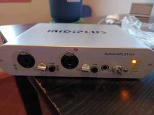
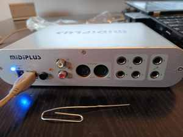

# Midiplus AudioLink Plus II

La Midiplus AudioLink Plus II se convirtió en uno de los casos más representativos de ISLA porque obligó a bajar hasta la capa del kernel para conservar hardware perfectamente utilizable.





## El problema

La interfaz no disponía de soporte GNU/Linux satisfactorio para el uso buscado. En lugar de descartarla, se trabajó sobre el driver libre **Ozzy** para incorporar soporte específico.

El proceso incluyó identificación USB, análisis de endpoints, inicialización y handshake, soporte de audio 4×4, MIDI DIN, pruebas SysEx, instrumentación y herramientas de loopback/sniffing.

La AudioLink es hoy la interfaz principal de ISLA y el dispositivo que fija el clock de JACK.

## El fallo SysEx

Durante las primeras pruebas, los mensajes SysEx largos se truncaban. Se revisó el camino de transmisión MIDI del driver y se implementó una gestión más robusta de buffer, cola y fases de envío.

```text
80 bytes    TX == RX
512 bytes   TX == RX
1024 bytes  TX == RX
4096 bytes  TX == RX
```

El resultado no fue sólo “hacer andar una placa”. Demostró un principio central:

> **La falta de soporte comercial no convierte automáticamente al hardware en residuo electrónico.**

Cuando el código puede estudiarse y modificarse, el límite deja de estar fijado por la decisión comercial de un fabricante.

## MIDI IN después de un reset por sample rate

En octubre de 2026 apareció un segundo problema importante al intentar usar el **Ensoniq SQ-1 como controlador MIDI principal**.

El SQ-1 transmitía correctamente y ALSA recibía las notas. Sin embargo, cuando JACK abría la AudioLink y un cambio de sample rate provocaba un reset USB del dispositivo, el MIDI IN desaparecía aunque el endpoint continuara activo.

El diagnóstico terminó mostrando un cambio de comportamiento de la propia AudioLink después del reset.

En funcionamiento normal, MIDI IN llega en registros USB de cinco bytes:

```text
byte 0  MIDI slot
byte 1  MIDI slot
byte 2  MIDI slot
byte 3  MIDI slot
byte 4  0xEB   framing fijo
```

Los slots inactivos contienen `0xFD`. El parser del driver compacta los cuatro primeros bytes válidos y descarta los `0xFD`.

Después de determinados resets por cambio de sample rate, la interfaz fue observada entregando MIDI como **completions USB cortas, a menudo de un solo byte**, en lugar del framing normal de cinco bytes.

El parser anterior sólo procesaba registros completos:

```c
for (base = 0; base + 5 <= length; base += 5) {
    ...
}
```

Por lo tanto, una transferencia de uno, dos, tres o cuatro bytes no entraba nunca al bucle y terminaba descartada. El síntoma parecía “MIDI IN muerto”, pero los bytes seguían llegando al endpoint.

La corrección fue reconocer explícitamente esas transferencias cortas y entregarlas a ALSA como MIDI raw:

```c
if (length < 5)
    return length;
```

El framing normal se conserva para transferencias de cinco bytes o más.

La corrección quedó validada atravesando cambios **44.1 kHz ↔ 96 kHz** sin perder MIDI IN.

Commit de referencia en Ozzy:

- `41afa0470becb9ec3703c351f73f10f29b72fb8d`
- **Fix AudioLink MIDI input after sample-rate reset**

Este fallo fue especialmente útil porque mostró que un problema que parecía pertenecer al SQ-1, a MusE o a JACK estaba realmente en una suposición del parser del driver sobre el framing USB.

## Topología USB y XRUNs

La AudioLink resultó también muy sensible a la topología USB de la estación.

En la ThinkPad T520 usada como implementación principal, la configuración estable mantiene la AudioLink en su controlador **EHCI** y separa del mismo bus los dispositivos auxiliares que puedan producir carga o resets inesperados.

Durante las pruebas de una entrada USB secundaria se comprobó una diferencia extrema:

```text
AudioLink y entrada USB auxiliar compartiendo camino/hub problemático
    → tormenta de XRUNs

AudioLink aislada en EHCI
entrada auxiliar + controlador MIDI en ExpressCard xHCI
    → XRUNs = 0 en la prueba equivalente
```

La lección no es que “los hubs USB no sirven para audio”. La lección es que **la topología real importa** y debe verificarse en cada máquina.

El comando básico para inspeccionarla es:

```bash
lsusb -t
```

En audio en tiempo real conviene saber no sólo qué dispositivo está conectado a qué puerto físico, sino también qué hub y qué controlador PCI comparte con la interfaz que actúa como reloj maestro.

## Interferencia RF en entradas analógicas

Durante el uso real aparecieron además episodios de interferencia con el sonido clásico de una transmisión celular demodulada sobre una entrada de micrófono.

La instalación tiene cerca un gateway celular multicanal, por lo que existe una fuente RF mucho más intensa que un teléfono aislado. La observación todavía se trata como un problema de compatibilidad electromagnética de la instalación, no como una falla demostrada de la AudioLink.

Un XLR balanceado rechaza muy bien ruido de modo común en banda de audio, pero no vuelve inmune a la entrada frente a RF. A cientos de MHz o GHz importan capacitancias e inductancias parásitas, terminación de blindaje, geometría del PCB y simetría de impedancias. Una juntura no lineal en la entrada puede además actuar como detector involuntario y convertir la envolvente RF en audio audible.

La primera estrategia es física: distancia, orientación, routing de cables y separación entre antenas/coaxiles y audio. Después pueden evaluarse ferritas y filtrado RF en la entrada.
