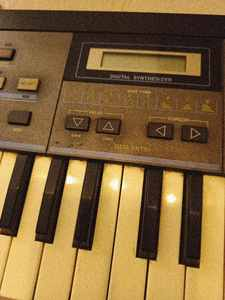
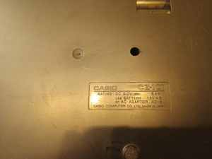
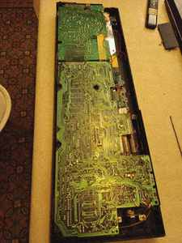
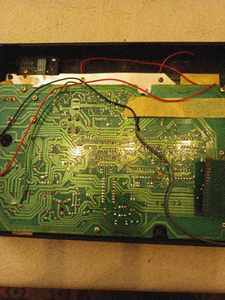
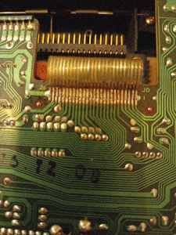
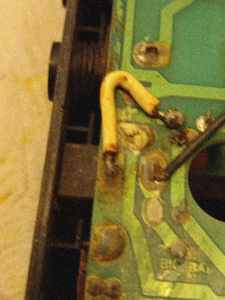
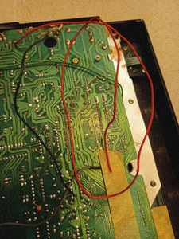
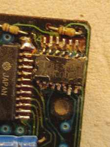
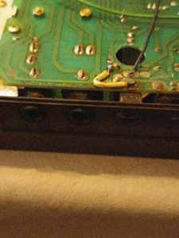
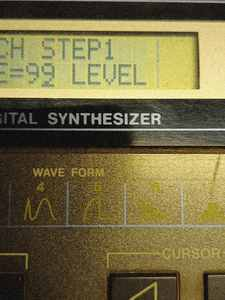

# Casio CZ-101

El Casio CZ-101 es una de las piezas que mejor resume la filosofía de ISLA: restauración física, estudio de MIDI/SysEx, preservación de sonidos históricos y creación de herramientas libres alrededor de hardware de los años 80.



*El panel del CZ conserva en serigrafía parte de la gramática de síntesis que décadas después volvió a representarse en el librarian.*

## Estado del instrumento

Durante la recuperación se encontraron problemas propios de décadas de almacenamiento y uso: suciedad interna, portapilas afectado por derrames, problemas mecánicos y contactos, memoria dependiente de alimentación de respaldo, componentes del cartucho que requerían revisión y jacks/potenciómetros a inspeccionar.



*La documentación fotográfica del estado original forma parte de la preservación: modelo, alimentación y detalles físicos quedan registrados antes de intervenir.*

## Interior y diagnóstico















Estas imágenes no son sólo ilustrativas: conservan orientación de conectores, cableado y estado previo a cualquier reparación.

## Patches manuscritos


*Anotaciones conservadas desde los años ochenta. Los parámetros escritos a mano se transforman en datos estructurados y pueden volver al sintetizador como SysEx.*

```text
hoja original
    ↓
transcripción
    ↓
modelo estructurado del patch
    ↓
SysEx
    ↓
CZ-101 real
```

## Librarian Web MIDI

El librarian/editor dejó de ser sólo una prueba de comunicación y se convirtió en una herramienta de trabajo real para el instrumento.

Repositorio:

- `Interspock/CZ_web_librarian`

La aplicación está hecha en HTML/CSS/JavaScript sin framework ni backend y utiliza Web MIDI con permiso SysEx.

Entre las funciones ya disponibles se encuentran:

- CRUD de patches en almacenamiento del navegador;
- importación y exportación JSON;
- editor visual de las seis envolventes DCO/DCW/DCA;
- parámetros principales del CZ;
- envío SysEx al edit buffer;
- destino opcional a **INTERNAL 1–16** con confirmación explícita;
- compatibilidad con bibliotecas anteriores que no tenían metadato de destino;
- Program Change y monitor MIDI;
- auto-audición de cambios mediante envío temporal + nota C4;
- Undo/Redo por patch;
- comparación temporal A/B;
- ayuda contextual de diseño sonoro;
- preview local experimental de síntesis PD para estudiar envolventes y bases Saw/Square.



El destino por defecto sigue siendo el **edit buffer (`0x60`)**, para que probar un patch no sobrescriba memoria interna. Los destinos INTERNAL 1–16 se guardan como metadato del patch y requieren `MEMORY PROTECT = OFF` en el sintetizador.

## Afinación remota

También se incorporó control de afinación desde la aplicación.

La acción de ajuste a A440 envía el control MIDI necesario para centrar el Master Tune. En la interfaz se integró como una operación de uso cotidiano, evitando depender del panel físico para una tarea repetitiva.

## Preservar compatibilidad mientras evoluciona el formato

Una regla importante del librarian es que nuevas funciones no deben invalidar bibliotecas ya guardadas.

Por ejemplo, al incorporar `meta.internalDestination`, los patches antiguos sin esa clave continúan cargando normalmente y se interpretan como destino **Edit buffer**.

Este detalle resume una idea importante de ISLA: preservar no es congelar. Se puede evolucionar una herramienta manteniendo legibles los datos anteriores.

## Rol dentro de MusE

Dentro de ISLA, el CZ se representa mediante una pista MIDI que envía notas y control y una pista de audio que recibe la salida física del sintetizador.


Así puede secuenciarse, grabarse y procesarse junto con instrumentos virtuales libres.

El librarian queda deliberadamente separado del DAW: MusE se ocupa de la producción musical y el librarian de preservar, editar y transferir el estado propio del instrumento.
