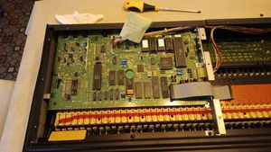

# Ensoniq SQ-1 y archivos históricos

El Ensoniq SQ-1 aporta a ISLA un problema diferente: no sólo preservar un instrumento, sino también recuperar el ecosistema de almacenamiento utilizado con él.



*El SQ-1 abierto durante la inspección. Además de la electrónica, el proyecto conserva la relación con patches, secuencias y soportes históricos.*

## Estado del instrumento

El SQ-1 continúa funcionando, aunque requiere mantenimiento: batería de respaldo agotada y una tecla grave sin respuesta.

Además de ser fuente sonora, el teclado del SQ-1 se utiliza como candidato natural a **controlador MIDI principal de rango amplio** dentro de ISLA.

Durante su uso original se almacenaron patches, bancos SysEx y secuencias mediante un secuenciador hardware Brother con disquetes de 3½ pulgadas. Todavía se conservan tanto la unidad como numerosos disquetes.

## El problema que apareció al usarlo como controlador

Al conectar el SQ-1 por MIDI DIN a la AudioLink Plus II, ALSA recibía correctamente las notas. El problema aparecía al abrir la interfaz de audio con JACK/MusE cuando un cambio de sample rate provocaba un reset USB de la AudioLink.

Después del reset, el SQ-1 seguía transmitiendo, pero **MIDI IN parecía desaparecer**.

Esto no era una falla del Ensoniq.

La AudioLink normalmente entrega MIDI IN al driver Ozzy en registros USB de cinco bytes:

```text
4 bytes de slots MIDI + 0xEB de framing
```

Después de determinados resets USB por sample rate se observó otro comportamiento: llegaban completions cortas, a menudo de **un solo byte raw**.

El parser original procesaba únicamente registros completos de cinco bytes, por lo que esas transferencias cortas se descartaban silenciosamente. La corrección en Ozzy fue permitir que las transferencias menores a cinco bytes pasaran directamente a ALSA como MIDI raw, preservando el parser de framing normal para el resto.

```c
if (length < 5)
    return length;
```

La corrección fue validada atravesando cambios **44.1 kHz ↔ 96 kHz** sin perder MIDI IN.

Commit de referencia:

- `Interspock/Ozzy`
- `41afa0470becb9ec3703c351f73f10f29b72fb8d`
- **Fix AudioLink MIDI input after sample-rate reset**

El episodio es importante para ISLA porque el síntoma aparecía al intentar usar un sintetizador histórico como teclado maestro, pero la causa real estaba varias capas más abajo: USB, framing y driver de kernel.

## Rol actual dentro de la estación

El SQ-1 puede participar de dos maneras:

```text
SQ-1 teclado
    │ MIDI OUT
    ▼
AudioLink MIDI IN
    │
    ▼
ALSA / MusE
    │
    ├──► instrumentos virtuales
    ├──► CZ-101
    ├──► K1r
    └──► SQ-1
```

Y al mismo tiempo puede funcionar como fuente sonora hardware, retornando audio analógico hacia la interfaz.

Esto permite aprovechar su teclado amplio sin renunciar al carácter sonoro del instrumento.

## Estrategia de recuperación de discos

```text
disquete original
      ↓
inspección física
      ↓
lectura no destructiva
      ↓
imagen maestra
      ↓
checksum
      ↓
copias de trabajo
      ↓
análisis de formato
      ↓
extracción de SysEx / secuencias
```

Los discos originales no deben utilizarse como superficie de experimentación. Una vez obtenida una imagen confiable, cualquier análisis debe realizarse sobre copias.
