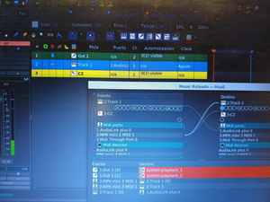

# MusE como centro de producción

MusE es actualmente el DAW alrededor del cual se consolidó ISLA.



*Controlador MIDI, AudioLink, pista MIDI del CZ y retorno de audio conviven dentro del mismo ruteo.*

## Por qué MusE

ISLA necesita un entorno que trate MIDI como material musical de primera clase y que permita integrar patrones, piano roll, hardware, instrumentos virtuales, audio multipista, routing, automatización y plugins libres.

Ardour fue probado extensamente y demostró enorme solidez, pero su paradigma resultó menos natural para el flujo compositivo buscado.

> **No adaptar al músico al DAW; buscar un DAW que se adapte al músico.**

La etapa de evaluación ya quedó atrás: MusE pasó a ser el centro operativo de la estación.

## Configuración de audio actual

La AudioLink Plus II actúa como dispositivo maestro de JACK.

La configuración de trabajo actual es:

```text
sample rate: 48 kHz
period:      512 frames
periods:     3
inputs:      4
outputs:     4
```

El lanzamiento se automatiza mediante un script de modo DAW que verifica hardware, prepara la topología USB, inicia JACK cuando es necesario y restaura el estado de la ThinkPad al salir.

La automatización incluye, entre otras tareas:

- comprobación de AudioLink y controlador MIDI;
- verificación de que dispositivos críticos no compartan el mismo controlador USB;
- deshabilitado temporal de cámara y Bluetooth internos;
- inicio y validación de JACK;
- preparación de `LV2_PATH`;
- detección de una entrada USB auxiliar y arranque de `alsa_in`;
- cleanup al terminar MusE.

## Integración de hardware

```text
                 ┌──────────────┐
                 │    MusE      │
                 └──────┬───────┘
                        │ MIDI
                        ▼
                   Casio CZ-101
                        │ audio
                        ▼
                    AudioLink
                        │
                        ▼
                 pista audio MusE
```

El mismo principio se aplica al Ensoniq SQ-1 y al Kawai K1r: el instrumento real puede secuenciarse desde MusE y retornar como audio a la mezcla.

El SQ-1 puede además actuar como teclado controlador principal. El fallo de MIDI IN que aparecía después de determinados resets de sample rate resultó ser un bug de parsing en el driver Ozzy de la AudioLink y quedó corregido.

## Una quinta entrada sin ocupar la AudioLink

ISLA incorpora también una entrada mono USB secundaria mediante `alsa_in`.

```text
USB Audio Device
      │
      ▼
   alsa_in
      │
      ▼
USB-IN:capture_1
      │
      ▼
Input de MusE
```

La AudioLink sigue siendo el master de JACK. `alsa_in` resamplea la entrada secundaria para compensar el clock independiente del dongle.

En esa entrada se utiliza como primer insert un high-pass muy bajo —aproximadamente 16–20 Hz— para eliminar un offset DC propio del dispositivo antes del resto de la cadena de efectos.

La caracterización completa está documentada en [Entrada USB auxiliar y topología USB](usb-audio-input.md).

## Batería multipista

Drumlabooh se utiliza en variante multi-output, con salidas separadas para poder procesar piezas de batería independientemente.

En lugar de obligar a cada salida a terminar directamente en el master, MusE permite agruparlas en buses de audio. Esto simplifica el tratamiento de kick, snare y del resto del kit con reverberación, compresión o ecualización diferentes.

El aprendizaje práctico fue que el routing visible en la interfaz debe verificarse siempre escuchando y siguiendo la ruta real de JACK/MusE: seleccionar puertos no necesariamente equivale a aislar canales si el plugin o la ruta elegida expone una salida agregada.

## Plugins y cadena de señal

Dentro de una misma sesión pueden convivir CZ-101, SQ-1, K1r, Surge XT, ISLA 800, Drumlabooh, kits Hydrogen y efectos LV2.

Para señales de audio externas la regla práctica es corregir primero los problemas estructurales de la entrada y recién después procesar musicalmente:

```text
entrada
  ↓
DC blocker / HPF si corresponde
  ↓
EQ correctivo
  ↓
compresión / dinámica
  ↓
saturación / carácter
  ↓
efectos de espacio
  ↓
mezcla
```

No todas las pistas necesitan toda la cadena. El principio es evitar que compresores, saturadores o amplificadores reciban DC o subgrave inútil cuando puede eliminarse al comienzo.

## USB también es parte del proyecto

Uno de los descubrimientos más importantes fue que el routing no termina en MusE.

En una estación de audio en tiempo real también hay que conocer:

```text
aplicación
   ↓
JACK
   ↓
ALSA
   ↓
driver
   ↓
controlador USB
   ↓
hub
   ↓
dispositivo
```

Una topología con un hub intermedio provocó una tormenta de errores y XRUNs en una prueba con la entrada secundaria. Con los dispositivos críticos conectados directamente y la AudioLink aislada en otro controlador USB, el mismo escenario volvió a XRUN = 0.

Por eso `lsusb -t` pasó a ser una herramienta tan importante para ISLA como `jack_lsp` o `aconnect`.
